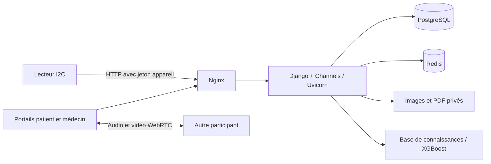

<div align="center">
  
  <h1>MediGo</h1>
  <p><strong>Une plateforme de téléconsultation reliant patients, médecins et capteurs connectés.</strong></p>
  <p>Django · PostgreSQL · Redis · WebRTC · XGBoost</p>
  <p>Portail patient français/arabe · Affichage arabe de droite à gauche</p>
  <p><a href="#installation">Installation</a> · <a href="#fonctionnalités">Fonctionnalités</a> · <a href="#structure-du-projet">Structure</a> · <a href="docs/REVIEW.md">Rapport de revue</a></p>
</div>

MediGo réunit les demandes de consultation, les échanges audio/vidéo, le dossier patient, les signes vitaux et les ordonnances PDF dans une même application.

Le projet a été réalisé dans le cadre d’un **Projet de Fin d’Année (PFA)** par :

- **Zakaria Ouakil** — Chef de projet
- **Aya Adrif**
- **Imane Guihia**

Le **portail patient est bilingue français/arabe**, avec prise en charge de l’affichage de droite à gauche (RTL). Les espaces médecin et administrateur sont principalement en français. Le bilinguisme ne désigne donc pas une traduction intégrale de tous les espaces.

**État du projet : prototype en développement.** Utilisez des patients fictifs pour les démonstrations. L’aide au diagnostic et les calculs issus des capteurs sont expérimentaux ; aucune validation clinique n’est fournie dans ce dépôt. Le [rapport de revue](docs/REVIEW.md) détaille les vérifications réalisées et les limites restantes.

## Fonctionnalités

| Espace | Fonctionnalités |
| --- | --- |
| Administration | Création des médecins et patients, activation des comptes, attribution du médecin traitant |
| Patient | Choix de langue, connexion par code, demande de consultation, historique, signes vitaux et ordonnances |
| Médecin | Disponibilité, file de consultations, dossier patient, symptômes, allergies et notes cliniques |
| Consultation en direct | Audio/vidéo WebRTC, messagerie, partage d’images et alertes via WebSocket |
| Capteurs connectés | Température avec MLX90614 et mesures optiques avec MAX30102, via un lecteur I2C séparé |
| Ordonnances | Génération de PDF et liens QR avec vérification du patient |
| Aide au diagnostic | Suggestions expérimentales issues d’une base de connaissances et, en option, d’un modèle XGBoost |

Le moteur à règles est actif par défaut. Le chargement du modèle XGBoost fourni s’est bloqué dans l’environnement de revue : validez sa compatibilité avant de définir `ENABLE_XGBOOST=True`.

## Architecture



Django gère les comptes, les dossiers et la signalisation des appels. Redis transporte les événements Channels. Les flux audio/vidéo passent entre les navigateurs ou par un relais TURN configuré séparément. Les fichiers privés sont servis après contrôle d’accès.

## Prérequis

| Composant | Version ou condition |
| --- | --- |
| Installation conteneurisée | Docker Engine/Desktop et Docker Compose v2 |
| Développement Python local | Python 3.13 et environnement virtuel |
| Base de données | PostgreSQL 15 dans Compose |
| Événements temps réel | Redis 7 dans Compose |
| Navigateur | Navigateur récent, autorisations caméra/microphone ; HTTPS hors localhost |
| Matériel facultatif | Linux, bus I2C 1, MLX90614 à `0x5a`, MAX30102 à `0x57` |

Les dépendances applicatives figurent dans [`backend/requirements.txt`](backend/requirements.txt). [`backend/requirements.lock.txt`](backend/requirements.lock.txt) consigne les versions résolues pendant la revue. Les dépendances matérielles sont séparées dans [`sensors/requirements.txt`](sensors/requirements.txt).

Aucune compilation Node.js n’est nécessaire. Les polices et icônes utilisent actuellement des CDN externes.

## Installation

### 1. Récupérer le projet

```bash
git clone https://github.com/zouakil/Medigo-Telemedicine-Platform.git
cd Medigo-Telemedicine-Platform
```

Si vous utilisez une archive source, placez-vous dans son dossier après extraction.

### 2. Préparer la configuration

Sous PowerShell :

```powershell
Copy-Item .env.example .env
```

Sous Linux/macOS :

```bash
cp .env.example .env
```

Remplacez `SECRET_KEY`, `DB_PASSWORD` et `SENSOR_API_KEY` dans `.env` par trois valeurs aléatoires distinctes. Pour générer chaque valeur avec Python :

```bash
python -c "import secrets; print(secrets.token_urlsafe(48))"
```

Ces valeurs sont propres à votre installation : elles ne doivent jamais être ajoutées au README ou au dépôt.

### 3. Démarrer les services

```bash
docker compose up --build -d
docker compose exec django python manage.py createsuperuser
```

Compose attend PostgreSQL et Redis, applique les migrations, collecte les fichiers statiques et démarre Uvicorn. Le port 80 est accessible **uniquement depuis localhost** dans cette configuration de développement.

### 4. Essayer une consultation

| Adresse | Usage |
| --- | --- |
| `http://localhost/` | Connexion du personnel et tableau de bord administrateur |
| `http://localhost/patient/` | Choix de langue et connexion patient |
| `http://localhost/django-admin/` | Administration Django |

1. Connectez-vous avec le superutilisateur créé précédemment.
2. Créez un médecin et un patient fictif, puis récupérez le code du patient.
3. Ouvrez les espaces médecin et patient dans deux profils de navigateur distincts.
4. Demandez une consultation depuis le portail patient, puis acceptez-la côté médecin.
5. Autorisez la caméra et le microphone pour essayer l’appel.

Pour consulter les journaux ou arrêter les services :

```bash
docker compose logs -f django
docker compose down
```

L’arrêt conserve le volume PostgreSQL et les fichiers locaux. Ne supprimez pas le volume de base de données si vous souhaitez conserver ses enregistrements.

## Développement local avec Python

Sous Windows :

```powershell
python -m venv .venv
.venv\Scripts\python -m pip install -r backend/requirements.lock.txt
```

Sous Linux/macOS, remplacez `.venv\Scripts\python` par `.venv/bin/python`. Le dossier **`.venv` contient les dépendances** ; le fichier **`.env` contient la configuration**. Ils sont exclus de Git.

Préparez PostgreSQL et Redis, puis adaptez `DB_HOST`, `DB_PORT` et `REDIS_URL` dans `.env`. Les services PostgreSQL et Redis de Compose n’exposent pas de ports sur l’hôte par défaut.

```powershell
.venv\Scripts\python backend/manage.py migrate
.venv\Scripts\python backend/manage.py createsuperuser
.venv\Scripts\python backend/manage.py collectstatic --noinput
.venv\Scripts\python -m uvicorn config.asgi:application --app-dir backend --reload
```

Ouvrez `http://localhost:8000` et ajoutez cette origine à `CSRF_TRUSTED_ORIGINS`. En exécution Python locale, les fichiers sont stockés dans `backend/media/`. Avec Compose, le montage utilise `media/` à la racine.

## Configuration

| Variable | Rôle |
| --- | --- |
| `SECRET_KEY` | Clé de signature Django à générer pour votre installation |
| `DEBUG` | `True` en développement local, `False` hors développement |
| `ALLOWED_HOSTS` | Noms d’hôtes séparés par des virgules, sans protocole ni chemin |
| `CSRF_TRUSTED_ORIGINS` | Origines autorisées, avec protocole et port éventuel |
| `DB_NAME`, `DB_USER`, `DB_PASSWORD`, `DB_HOST`, `DB_PORT` | Connexion PostgreSQL |
| `REDIS_URL` | Connexion Redis utilisée par Channels |
| `SENSOR_API_KEY` | Jeton partagé avec le lecteur ; une valeur vide désactive les API appareil |
| `MEDIGO_BASE_URL` | Adresse du serveur utilisée par le lecteur de capteurs |
| `ENABLE_XGBOOST` | `False` par défaut, jusqu’à validation du modèle |
| `TURN_URLS`, `TURN_USERNAME`, `TURN_CREDENTIAL` | Configuration facultative du relais WebRTC |
| `SESSION_COOKIE_SECURE`, `CSRF_COOKIE_SECURE`, `SECURE_SSL_REDIRECT` | Paramètres HTTPS, désactivés par défaut pour localhost |

Les identifiants TURN sont transmis aux clients vidéo. Pour un déploiement, prévoyez des identifiants limités et temporaires. Le mode STUN seul peut échouer sur certains réseaux. Le dépôt ne fournit ni serveur TURN ni certificats TLS.

## Capteurs connectés — facultatif

Sur l’appareil Linux, activez I2C et autorisez l’accès au bus. Installez les dépendances dans un environnement virtuel propre à cet appareil :

```bash
python3 -m venv .venv
.venv/bin/python -m pip install -r sensors/requirements.txt
.venv/bin/python sensors/reader.py
```

Définissez `MEDIGO_BASE_URL` et le même `SENSOR_API_KEY` dans le fichier `.env` de l’appareil. Le lecteur transmet le jeton via l’en-tête `X-Sensor-Key`.

Un appareil distant nécessite une adresse serveur accessible : l’écoute sur localhost fournie par défaut ne permet pas cette connexion. Le lecteur sélectionne actuellement la consultation active la plus récente ; le parcours matériel est limité à une seule consultation à la fois. La précision et l’étalonnage des capteurs n’ont pas été validés pendant la revue.

## Catalogue de médicaments

Le CSV du catalogue n’est pas fourni. La recherche reste vide jusqu’à l’import d’un catalogue ou la création d’entrées dans l’administration Django. L’import accepte un fichier UTF-8 avec ces colonnes :

```text
STATUT AMM,STATUT COMMERCIALISATION,SPECIALITE,DOSAGE,FORME,SUBSTANCE ACTIVE,CLASSE THERAPEUTIQUE
```

```powershell
.venv\Scripts\python backend/import_medicaments.py chemin/medicaments.csv
```

L’import conserve les filtres d’enregistrement et de commercialisation existants, ignore les doublons exacts et s’exécute dans une transaction. Il ne supprime pas le catalogue existant. Vérifiez les droits de redistribution de toute source ajoutée.

## Tests et vérifications

Ces commandes utilisent une base SQLite en mémoire et une couche Channels isolée. Elles ne nécessitent ni PostgreSQL, ni Redis, ni secrets de déploiement :

```powershell
.venv\Scripts\python -m pip check
.venv\Scripts\python backend/manage.py check --settings=config.test_settings
.venv\Scripts\python backend/manage.py makemigrations --check --dry-run --settings=config.test_settings
.venv\Scripts\python backend/manage.py test apps --settings=config.test_settings
```

La revue a validé **20 tests de régression**, la compilation des **29 templates**, la collecte des fichiers statiques, la cohérence des dépendances et l’absence de migrations manquantes. GitHub Actions est configuré pour exécuter les contrôles principaux.

Ces résultats ne couvrent pas les appels vidéo dans un navigateur, le démarrage Docker, la concurrence PostgreSQL ou le matériel physique. Consultez le [rapport détaillé](docs/REVIEW.md).

## Structure du projet

```text
Medigo-Telemedicine-Platform/
├── backend/
│   ├── apps/                  # Modules métier Django
│   │   ├── accounts/          # Comptes et profils médecins
│   │   ├── consultations/     # Parcours, API, WebSockets et tests
│   │   ├── i18n_patient/      # Traductions français/arabe
│   │   ├── messaging/         # Messages, images et accès aux médias
│   │   ├── ordonnances/       # Ordonnances et génération PDF
│   │   ├── patients/          # Dossiers et relations avec les médecins
│   │   └── sensors/           # API de mesures et de contrôle
│   ├── config/                # Django, ASGI et tests isolés
│   ├── medigo_ai/             # Base de connaissances et modèle
│   ├── static/                # Images et données JSON sources
│   ├── templates/             # Interfaces HTML
│   ├── manage.py
│   ├── Dockerfile
│   └── requirements*.txt      # Dépendances et versions résolues
├── sensors/                   # Lecteur I2C indépendant du serveur
├── nginx/                     # Proxy HTTP et WebSocket
├── scripts/                   # Export du code source
├── docs/                      # Rapport technique
├── .github/workflows/         # Vérifications automatisées
├── .env.example               # Exemple de configuration
├── docker-compose.yml
├── LICENSE                    # Licence MIT
└── README.md
```

Le nettoyage sépare le code source des fichiers générés : environnements virtuels, médias, PDF et fichiers statiques collectés sont exclus du suivi Git. Les anciens scripts de correction et sauvegardes locales sont regroupés dans `.local/archive/`, également exclu de Git et de l’export. Les modules métier, migrations et templates sont nécessaires à Django ; leur nombre est normal pour les fonctionnalités proposées. Le découpage des gros fichiers de vues et des scripts intégrés aux templates reste une amélioration à poursuivre.

## Export du code source

Pour créer une archive du code source :

```powershell
.venv\Scripts\python scripts/export_source.py
```

Extrayez `.release/MediGo-source.zip` dans un dossier séparé et vérifiez son contenu. L’archive exclut l’historique Git, les fichiers `.env`, les environnements virtuels et les médias générés.

Le modèle `.joblib` inclus pèse environ 69 Mio. Son pipeline d’entraînement et sa fiche de modèle ne sont pas fournis ; vérifiez sa provenance et sa compatibilité avant utilisation ou redistribution.

## Licence

Le projet est distribué sous [licence MIT](LICENSE).

Copyright © 2026 Zakaria Ouakil.

Les droits applicables aux modèles, données de référence et autres ressources tierces doivent être vérifiés séparément.
